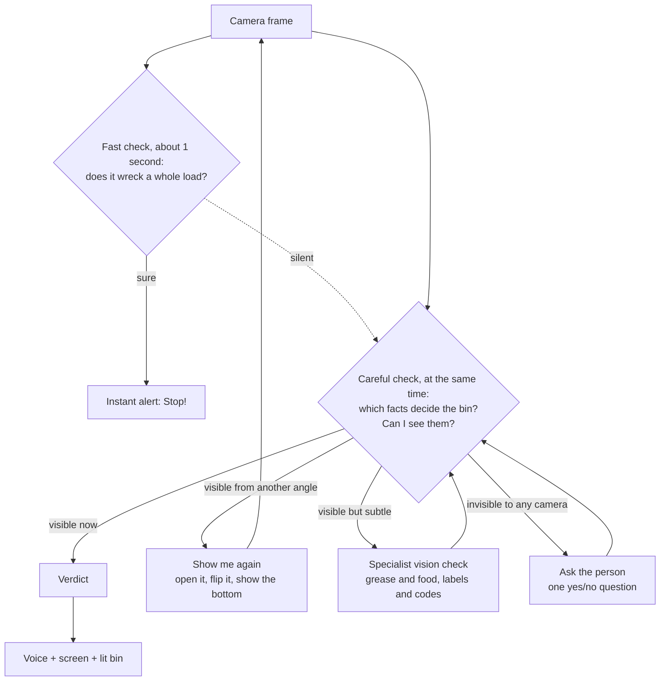

# Sorty: the bin that looks twice and asks

Sorty is an AI assistant for waste stations. A camera on the bin sees what a person is holding, and a voice plus a screen tell them which bin to use. It works with any camera and any bin layout.

What makes it different from a camera that classifies a photo: Sorty knows what it **cannot** see, and does something about it.

| Situation | Example | What Sorty does |
|---|---|---|
| It would wreck the whole load | Battery, vape, phone, plastic bag, bag of trash | **Instant alert** in about a second: "Stop! Not in these bins." |
| The answer is visible | Clear bottle, visibly empty | Answers at once: "Blue bin, on your left." |
| A camera could see it, but not from here | Closed pizza box | "Open the box and show me inside." Then looks again. |
| Visible but subtle | Is that grease or a shadow? Tiny print on a cup | Runs a specialist vision check on the frame |
| No camera can ever see it | Is there liquid in the soda can? | Asks the person a yes/no question |

It never keeps people waiting: at most three requests per item, and if the person does not know or walks away, it gives the answer that is safe either way.

### The instant alert

A few items do far more damage than an ordinary sorting mistake. Batteries, vapes and phones can start fires in collection trucks and sorting plants, plastic bags wrap around the sorting machines, and a bag of trash spoils what is around it. For these, a fast warning matters more than a nuanced answer.

So the moment the station activates, **two AI models start on the same camera frame at the same time**:

- a small, fast one that asks a single question: is this one of the few things that wreck a whole load?
- the careful one, which may look again, ask the person and run specialist checks.

If the fast model is sure, the screen turns red and Sorty says "Stop!" with where the item goes instead, without waiting for the careful answer. If it is not sure it stays silent and the careful model answers as usual, so the alert can only make Sorty faster, never less careful.

Which model raises the alert: Claude Haiku 5.5 by default. With a `JEV_API_KEY` in `sorty/.env`, the alert runs on Jev, TypeSafe AI's decision model (one Choice question over the picture, answered with a confidence), and Claude Haiku stays as the net if Jev cannot be reached. The Jev path is covered by offline checks with a stand-in; see "Tested" for whether it has been run against the real service.

### A multi-agent workflow

Four AI agents, each with one job:

1. **Alert agent** (Claude Haiku 5.5, or Jev): does this wreck a whole load?
2. **Orchestrator agent** (Claude Opus 5.5, a LangGraph graph): which fact decides the bin, and what is the next move? It can answer, ask the person, ask to see another side, or call one of the next two.
3. **Inspector agent**: a closer look at a zoomed picture for grease, food or mold, reported on a fixed form.
4. **Label agent**: reads resin codes, compostable marks and other small print.

Agents 1 and 2 start at the same moment. Agents 3 and 4 run only when the orchestrator calls them.

## Try it

1. Put your Anthropic API key in `sorty/.env`:
   ```
   ANTHROPIC_API_KEY=sk-ant-...
   ```
2. Start it (Windows): double-click `sorty\run.bat`, or from a terminal:
   ```
   sorty\run.bat
   ```
   The first run sets up Python packages by itself.
3. Open http://localhost:8787 in Chrome or Edge and allow the camera.

Hold something up to the camera. Without a key, Sorty starts in a scripted demo mode so the screen and voice can still be shown.

No camera handy? Press **M** on the screen for demo mode: pick a test scenario and Sorty runs on its pictures. Press **D** to see how Sorty decided, step by step.

## How it decides



- The careful brain is Claude with vision (`claude-opus-5-5` by default), called through the official Anthropic SDK. Each step it picks exactly one move.
- The instant alert (`sorty/brain/guard.py`) is the fastest Claude model (`claude-haiku-5-5`) with a small picture, no thinking step and a fixed answer shape. It is pluggable: a small detector running on the bin's own computer can take the place of the cloud call. Switch it off with `SORTY_GUARD=0`.
- The careful loop exists in two forms that produce the same turns: a plain loop (`sorty/brain/agent.py`) and a LangGraph graph (`sorty/brain/graph_brain.py`: think, specialist, person, with a pause while the person answers). Choose with `SORTY_ORCHESTRATOR=classic` or `langgraph`. The LangGraph form can also run on Gemini (`GEMINI_API_KEY` in `sorty/.env` and `SORTY_PROVIDER=google`); that path is written but has not been run against Google's service yet.
- The rules of the station (which bin is where, what goes in it) live in one JSON file per station, so the same brain runs a 3-bin or a 2-bin layout: `sorty/brain/rules/`.
- Some limits are enforced in code, not left to the model: at most three requests to the person per item, only bins that exist on the station can be named, a spending cap, and a fallback message ("Please check the labels on the bins") when the AI cannot be reached. One rule lives only in the AI's instructions and has not been tested: what a person says is treated as information about the item, never as an instruction.
- Specialist checks are pluggable. The two built in are focused inspection passes; a trained detector running on the bin's own computer can replace either one (see `sorty/brain/specialists.py`).

## Designed around how people behave at a bin

People decide where to throw something in two or three seconds, usually while walking and thinking about something else. The screen and voice are built for that.

| What we know about people | What Sorty does |
|---|---|
| More choices means slower, worse decisions | One answer, never a list of options |
| People react fastest when the cue points at the target | A huge arrow points at the real bin, the screen takes the bin's color, and only that bin lights up |
| Color alone fails for color-blind users and in bad light | Color, arrow, icon, word and voice always say the same thing |
| Working memory is small when standing and distracted | Sentences of eight words or fewer, verb first, everyday words ("greasy", not "contaminated") |
| The same sentence shape is learned after one use | Every verdict sounds the same: "Blue bin, on your left." then a short reason |
| A short "because" makes people comply and remember | Each verdict carries one brief reason ("Grease spoils paper recycling.") |
| Waiting without feedback feels broken | The screen reacts within a fraction of a second, even while the AI thinks |
| People resist being corrected | No blame, ever. Questions explain themselves ("I can't see inside the can.") |
| Closed questions are easier than open ones | Yes / No / Not sure, by voice or big buttons |
| The last moment colors the memory of the whole exchange | It ends with a thank-you |

## Tested

Three layers of tests live in `sorty/tests/`:

- `test_offline.py` and `test_graph.py`: 169 and 56 checks of the decision loop (both forms), the instant alert, turn format, request limit, failure handling and server. No key or network needed. They check the plumbing, not the AI's judgement.
- `run_scenarios.py`: live runs against a bank of 36 scenarios (`scenarios.json`). Each scenario has camera frames and a hidden truth, for example "the can is half full". A simulated person answers Sorty's questions from that truth, and the final answer is graded. It can also compare Sorty with a one-look camera that uses the same model and rules but may not look again or ask.
- `run_guard.py`: shows every test picture to the instant alert alone and counts the load-wreckers it caught, the false alarms and the time.

Results with the live AI on 2026-11-21 (the reports are in `sorty/tests/results/`):

| What was tested | Result |
|---|---|
| One-look camera, 33 scenarios (same model, same rules, same pictures) | 28 of 33 right; 9 of 14 on the items whose answer is hidden |
| Sorty, the same 33 scenarios (plain loop) | 32 of 33 right; 13 of 14 on the hidden ones; 5.0 s average thinking time |
| Sorty on the LangGraph brain, 36 scenarios | 35 of 36 right; 4.9 s average thinking time |
| Instant alert, 5 load-wrecker pictures shown twice | alert raised on 10 of 10 |
| Instant alert, 26 ordinary pictures shown twice | 0 false alarms in 52 |
| Time for one fast look | about 1 second (slowest 2.8 s) |

The one miss is the same in both runs: a paper coffee cup, where Sorty sent the cardboard sleeve to recycling and our answer key says the whole cup is landfill.

Limits: the pictures are Blender renders, not photos from a real bin camera; each figure comes from a single run; each load-wrecker has only one picture; the cheapest model tried as the careful brain skipped the soda-can question; the Gemini path has not been run; the Jev alert path has been run only against a stand-in, not the real service (the alert figures above are from Claude Haiku 5.5); and nothing has been tested on a real bin.

```
cd sorty
.venv\Scripts\python.exe -m tests.test_offline
.venv\Scripts\python.exe -m tests.test_graph
.venv\Scripts\python.exe -m tests.run_guard
.venv\Scripts\python.exe -m tests.run_scenarios --baseline
```

## The virtual prototype

No physical unit exists yet, so the station is shown as a virtual prototype at http://localhost:8787/showcase/ (start Sorty first). A person walks up, shows an item to the camera, Sorty speaks, and the right bin lights up. The scene is made of Blender renders; the screen next to it is the real kiosk software, running live.

How to use it:

- **Pick an item** in the tray at the bottom. The person walks up with it and the story plays out.
- **Auto-answer** on: a simulated person answers Sorty's questions. Off: you answer with the buttons that appear under the scene.
- **Play fast tour** shows a line of eight people served one after another, with a stopwatch on the stage. Two of them are in a hurry and walk straight at the recycling bin with a load-wrecker; the instant alert stops them. In the one live run timed today, eight people were served in 30.9 seconds.
- **Use my camera** lets you hold a real object up to your webcam (use Chrome or Edge and allow the camera). The live view stays on, in the virtual person's hands and in the camera panel, so you can see what you are showing. A **Press SPACE now** cue tells you when it is your turn; press the **Sensor: object in range** button or the Space key to start. The button stands in for the distance sensor a real bin would have. This needs an API key to be meaningful: in practice mode the answers are scripted and Sorty is not really looking at your object.
- **Load-wreckers**: show a battery, a vape, a phone or a plastic bag and the instant alert fires in about a second: red screen, "Stop!", and where the item goes instead.
- **Faster mode** switches the careful brain to a quicker, cheaper model. **Practice mode** switches to scripted answers by hand, for when the connection fails.
- **AI spend** at the top shows the estimated cost so far against a limit (5 dollars by default, `SORTY_BUDGET_USD`). When the limit is reached Sorty stops calling the AI and goes back to practice mode.
- The five-slide pitch deck is at http://localhost:8787/showcase/deck/.
- The right-hand column shows Sorty's real screen, the exact picture sent to the AI, and each step of how Sorty decided.
- The badge at the top says whether answers come from the live AI or from practice mode (scripted answers, used when no API key is set).

## Putting it on a real bin

- Any USB or built-in camera, a small screen, a speaker, and a computer that runs a browser and Python (a mini PC or a Raspberry Pi class board). The screen runs the kiosk page full-screen.
- Describe the station in a profile file: copy `sorty/brain/rules/station_3bin.json`, set each bin's position, color and local rules, and start with `SORTY_STATION=<name>`.
- To light the LED of the right bin, set `SORTY_NOTIFY_URL` to your controller's address. Every verdict is sent there as JSON.
- Frames are held in memory for one interaction and are not saved.

## Project layout

```
sorty/
  brain/        the instant alert, the decision loop (plain and LangGraph), prompts, tools, specialist checks, station rules
  server/       local web server: kiosk page + API
  kiosk/        the screen and voice interface (plain HTML, CSS, JavaScript)
  showcase/     the virtual prototype and the pitch deck
  tests/        scenario bank, test images, offline and live test runners, results
  design/       Blender model and renders of the station
pitch/          the 3-minute script and submission text
business/       cost estimate
```

## Credits: tools, frameworks and AI usage

Built at HackJam '26. This section says plainly what was used, what was generated by AI, and what the team did.

### Frameworks, libraries and tools

| Part | What it uses |
|---|---|
| Brain and server | Python 3.13; the official Anthropic Python SDK (`anthropic`) to call the Claude API; LangGraph with `langchain-anthropic` and `langchain-google-genai` for the graph form of the decision loop; Pillow for image handling; Python's standard library web server (no web framework) |
| AI models inside the product | Claude with vision, by Anthropic: `claude-opus-5-5` decides which bin an item goes in (the Faster mode uses `claude-sonnet-5-5`), and `claude-haiku-5-5` is the instant alert. Google's Gemini (`gemini-3.8-flash`) is supported in code through LangGraph but has not been run yet. TypeSafe AI's Jev (`jev-latest`) is supported in code as the alert model, called over plain HTTPS with no extra package, and has not been run against the real service yet |
| Screen, voice and virtual prototype | Plain HTML, CSS and JavaScript with no framework and no build step; the browser's Web Speech API (speech synthesis and recognition), Web Audio API and camera API (`getUserMedia`) |
| 3D design, renders and test pictures | Blender 5.2 (Cycles renderer), driven by Python scripts; FFmpeg to stitch images and encode the turntable video; system fonts |
| Development | Claude Code (Anthropic's AI coding assistant, running Claude Fable 5.2), Git and GitHub |

### What was generated by AI

- **All source code in this repository** was written by Claude Code, working from the team's instructions: the brain (`sorty/brain`), the server (`sorty/server`), the kiosk screen and voice (`sorty/kiosk`), the virtual prototype (`sorty/showcase`), and the tests (`sorty/tests`).
- **The Blender scripts** (`sorty/design`, `sorty/tests/render`) were written by Claude Code, and every image and video in this repository is a Blender render produced by those scripts: the station design, the virtual prototype's layers, and the 31 test pictures. No AI image generator and no stock photos or downloaded 3D models were used.
- **The written documents** were drafted by Claude Code: this README, the pitch script in `pitch/`, the cost estimate in `business/`, the bin rules in `sorty/brain/rules`, and the 36 test scenarios. The research summarised in the design table above was recalled by the AI from published work and has not been checked against the original papers by the team.
- **At run time**, the sorting decisions are made by the Claude model. Without an API key the product runs in a clearly labelled practice mode with scripted answers.

### What the team did

- Chose the problem and came up with the idea: a camera assistant that can be added to any bin.
- Defined how it must behave: speak and show the answer, ask the person to open or turn an item and look again, query a vision check for subtle details, and ask a question when no camera can know (the pizza box and soda can cases).
- Made the product decisions: three bins, the design-for-people requirement, which AI service to use, testing against many scenarios, a Blender design, and a virtual prototype instead of a physical one.
- Directed and reviewed the AI's work throughout, and prepared and gave the pitch.

<!-- Team: add anything else you made by hand here, so this section stays accurate. -->
