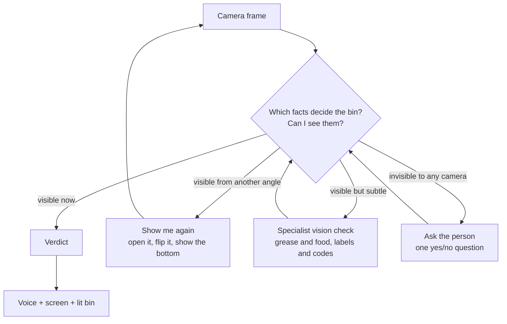

# Sorty: the bin that looks twice and asks

Sorty is an AI assistant for waste stations. A camera on the bin sees what a person is holding, and a voice plus a screen tell them which bin to use. It works with any camera and any bin layout.

What makes it different from a camera that classifies a photo: Sorty knows what it **cannot** see, and does something about it.

| Situation | Example | What Sorty does |
|---|---|---|
| The answer is visible | Clear bottle, visibly empty | Answers at once: "Blue bin, on your left." |
| A camera could see it, but not from here | Closed pizza box | "Open the box and show me inside." Then looks again. |
| Visible but subtle | Is that grease or a shadow? Tiny print on a cup | Runs a specialist vision check on the frame |
| No camera can ever see it | Is there liquid in the soda can? | Asks the person a yes/no question |

It never keeps people waiting: at most three requests per item, and if the person does not know or walks away, it gives the answer that is safe either way.

## Try it

1. Put your Anthropic API key in `sorty/.env`:
   ```
   ANTHROPIC_API_KEY=sk-ant-...
   ```
2. Start it (Windows): double-click `sorty\run.bat`, or from a terminal:
   ```
   sorty\run.bat
   ```
   The first run sets up Python packages by itself.
3. Open http://localhost:8787 in Chrome or Edge and allow the camera.

Hold something up to the camera. Without a key, Sorty starts in a scripted demo mode so the screen and voice can still be shown.

No camera handy? Press **M** on the screen for demo mode: pick a test scenario and Sorty runs on its pictures. Press **D** to see how Sorty decided, step by step.

## How it decides



- The brain is Claude with vision (`claude-opus-5-5` by default), called through the official Anthropic SDK. Each step it picks exactly one move.
- The rules of the station (which bin is where, what goes in it) live in one JSON file per station, so the same brain runs a 3-bin or a 2-bin layout: `sorty/brain/rules/`.
- Guardrails are enforced in code, not left to the model: a hard budget of requests to the person, only bins that exist can be named, every interaction ends with an answer even if the network fails, and nothing a person says is treated as an instruction.
- Specialist checks are pluggable. The two built in are focused inspection passes; a trained detector running on the bin's own computer can replace either one (see `sorty/brain/specialists.py`).

## Designed around how people behave at a bin

People decide where to throw something in two or three seconds, usually while walking and thinking about something else. The screen and voice are built for that.

| What we know about people | What Sorty does |
|---|---|
| More choices means slower, worse decisions | One answer, never a list of options |
| People react fastest when the cue points at the target | A huge arrow points at the real bin, the screen takes the bin's color, and only that bin lights up |
| Color alone fails for color-blind users and in bad light | Color, arrow, icon, word and voice always say the same thing |
| Working memory is small when standing and distracted | Sentences of eight words or fewer, verb first, everyday words ("greasy", not "contaminated") |
| The same sentence shape is learned after one use | Every verdict sounds the same: "Blue bin, on your left." then a short reason |
| A short "because" makes people comply and remember | Each verdict carries one brief reason ("Grease spoils paper recycling.") |
| Waiting without feedback feels broken | The screen reacts within a fraction of a second, even while the AI thinks |
| People resist being corrected | No blame, ever. Questions explain themselves ("I can't see inside the can.") |
| Closed questions are easier than open ones | Yes / No / Not sure, by voice or big buttons |
| The last moment colors the memory of the whole exchange | It ends with a thank-you |

## Tested

Two layers of tests live in `sorty/tests/`:

- `test_offline.py`: 107 checks of the decision loop, turn format, request budget, failure handling and server. No key or network needed.
- `run_scenarios.py`: live runs against a bank of 32 scenarios (`scenarios.json`). Each scenario has camera frames and a hidden truth, for example "the can is half full". A simulated person answers Sorty's questions from that truth, and the final answer is graded. It also compares Sorty with a one-look camera that uses the same model and rules but may not look again or ask.

Results of the latest live run: see `sorty/tests/results/REPORT.md`.

```
cd sorty
.venv\Scripts\python.exe -m tests.test_offline
.venv\Scripts\python.exe -m tests.run_scenarios --baseline
```

## Putting it on a real bin

- Any USB or built-in camera, a small screen, a speaker, and a computer that runs a browser and Python (a mini PC or a Raspberry Pi class board). The screen runs the kiosk page full-screen.
- Describe the station in a profile file: copy `sorty/brain/rules/station_3bin.json`, set each bin's position, color and local rules, and start with `SORTY_STATION=<name>`.
- To light the LED of the right bin, set `SORTY_NOTIFY_URL` to your controller's address. Every verdict is sent there as JSON.
- Frames are held in memory for one interaction and are not saved.

## Project layout

```
sorty/
  brain/        the decision loop, prompts, tools, specialist checks, station rules
  server/       local web server: kiosk page + API
  kiosk/        the screen and voice interface (plain HTML, CSS, JavaScript)
  tests/        scenario bank, test images, offline and live test runners
  design/       Blender model and renders of the station
```
