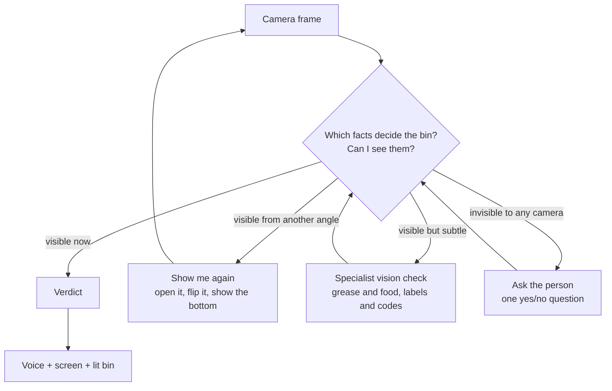

# Sorty: the bin that looks twice and asks

Sorty is an AI assistant for waste stations. A camera on the bin sees what a person is holding, and a voice plus a screen tell them which bin to use. It works with any camera and any bin layout.

What makes it different from a camera that classifies a photo: Sorty knows what it **cannot** see, and does something about it.

| Situation | Example | What Sorty does |
|---|---|---|
| The answer is visible | Clear bottle, visibly empty | Answers at once: "Blue bin, on your left." |
| A camera could see it, but not from here | Closed pizza box | "Open the box and show me inside." Then looks again. |
| Visible but subtle | Is that grease or a shadow? Tiny print on a cup | Runs a specialist vision check on the frame |
| No camera can ever see it | Is there liquid in the soda can? | Asks the person a yes/no question |

It never keeps people waiting: at most three requests per item, and if the person does not know or walks away, it gives the answer that is safe either way.

## Try it

1. Put your Anthropic API key in `sorty/.env`:
   ```
   ANTHROPIC_API_KEY=sk-ant-...
   ```
2. Start it (Windows): double-click `sorty\run.bat`, or from a terminal:
   ```
   sorty\run.bat
   ```
   The first run sets up Python packages by itself.
3. Open http://localhost:8787 in Chrome or Edge and allow the camera.

Hold something up to the camera. Without a key, Sorty starts in a scripted demo mode so the screen and voice can still be shown.

No camera handy? Press **M** on the screen for demo mode: pick a test scenario and Sorty runs on its pictures. Press **D** to see how Sorty decided, step by step.

## How it decides



- The brain is Claude with vision (`claude-opus-5-5` by default), called through the official Anthropic SDK. Each step it picks exactly one move.
- The rules of the station (which bin is where, what goes in it) live in one JSON file per station, so the same brain runs a 3-bin or a 2-bin layout: `sorty/brain/rules/`.
- Some limits are enforced in code, not left to the model: at most three requests to the person per item, only bins that exist on the station can be named, a spending cap, and a fallback message ("Please check the labels on the bins") when the AI cannot be reached. One rule lives only in the AI's instructions and has not been tested: what a person says is treated as information about the item, never as an instruction.
- Specialist checks are pluggable. The two built in are focused inspection passes; a trained detector running on the bin's own computer can replace either one (see `sorty/brain/specialists.py`).

## Designed around how people behave at a bin

People decide where to throw something in two or three seconds, usually while walking and thinking about something else. The screen and voice are built for that.

| What we know about people | What Sorty does |
|---|---|
| More choices means slower, worse decisions | One answer, never a list of options |
| People react fastest when the cue points at the target | A huge arrow points at the real bin, the screen takes the bin's color, and only that bin lights up |
| Color alone fails for color-blind users and in bad light | Color, arrow, icon, word and voice always say the same thing |
| Working memory is small when standing and distracted | Sentences of eight words or fewer, verb first, everyday words ("greasy", not "contaminated") |
| The same sentence shape is learned after one use | Every verdict sounds the same: "Blue bin, on your left." then a short reason |
| A short "because" makes people comply and remember | Each verdict carries one brief reason ("Grease spoils paper recycling.") |
| Waiting without feedback feels broken | The screen reacts within a fraction of a second, even while the AI thinks |
| People resist being corrected | No blame, ever. Questions explain themselves ("I can't see inside the can.") |
| Closed questions are easier than open ones | Yes / No / Not sure, by voice or big buttons |
| The last moment colors the memory of the whole exchange | It ends with a thank-you |

## Tested

Two layers of tests live in `sorty/tests/`:

- `test_offline.py`: 113 checks of the decision loop, turn format, request limit, failure handling and server. No key or network needed. They check the plumbing, not the AI's judgement.
- `run_scenarios.py`: live runs against a bank of 32 scenarios (`scenarios.json`). Each scenario has camera frames and a hidden truth, for example "the can is half full". A simulated person answers Sorty's questions from that truth, and the final answer is graded. It also compares Sorty with a one-look camera that uses the same model and rules but may not look again or ask.

Status: the offline checks pass. With the live AI, only a handful of items have been run through the full loop (half-full soda can, greasy pizza box, clean pizza box, banana peel), on Blender-rendered pictures; the logs are in `sorty/tests/results/`. On the default model every completed run came out right. The cheapest model tried skipped the soda-can question. The full 32-case run with the one-look comparison has not been done, so there is no accuracy figure, and nothing has been tested with a real camera on a real bin.

```
cd sorty
.venv\Scripts\python.exe -m tests.test_offline
.venv\Scripts\python.exe -m tests.run_scenarios --baseline
```

## The virtual prototype

No physical unit exists yet, so the station is shown as a virtual prototype at http://localhost:8787/showcase/ (start Sorty first). A person walks up, shows an item to the camera, Sorty speaks, and the right bin lights up. The scene is made of Blender renders; the screen next to it is the real kiosk software, running live.

How to use it:

- **Pick an item** in the tray at the bottom. The person walks up with it and the story plays out.
- **Auto-answer** on: a simulated person answers Sorty's questions. Off: you answer with the buttons that appear under the scene.
- **Play tour** runs five items in a row, hands-free.
- **Use my camera** lets you hold a real object up to your webcam (use Chrome or Edge and allow the camera). The live view stays on, in the virtual person's hands and in the camera panel, so you can see what you are showing. A **Press SPACE now** cue tells you when it is your turn; press the **Sensor: object in range** button or the Space key to start. The button stands in for the distance sensor a real bin would have. This needs an API key to be meaningful: in practice mode the answers are scripted and Sorty is not really looking at your object.
- **AI spend** at the top shows the estimated cost so far against a limit (5 dollars by default, `SORTY_BUDGET_USD`). When the limit is reached Sorty stops calling the AI and goes back to practice mode.
- The right-hand column shows Sorty's real screen, the exact picture sent to the AI, and each step of how Sorty decided.
- The badge at the top says whether answers come from the live AI or from practice mode (scripted answers, used when no API key is set).

## Putting it on a real bin

- Any USB or built-in camera, a small screen, a speaker, and a computer that runs a browser and Python (a mini PC or a Raspberry Pi class board). The screen runs the kiosk page full-screen.
- Describe the station in a profile file: copy `sorty/brain/rules/station_3bin.json`, set each bin's position, color and local rules, and start with `SORTY_STATION=<name>`.
- To light the LED of the right bin, set `SORTY_NOTIFY_URL` to your controller's address. Every verdict is sent there as JSON.
- Frames are held in memory for one interaction and are not saved.

## Project layout

```
sorty/
  brain/        the decision loop, prompts, tools, specialist checks, station rules
  server/       local web server: kiosk page + API
  kiosk/        the screen and voice interface (plain HTML, CSS, JavaScript)
  tests/        scenario bank, test images, offline and live test runners
  design/       Blender model and renders of the station
```

## Credits: tools, frameworks and AI usage

Built at HackJam '26. This section says plainly what was used, what was generated by AI, and what the team did.

### Frameworks, libraries and tools

| Part | What it uses |
|---|---|
| Brain and server | Python 3.13; the official Anthropic Python SDK (`anthropic`) to call the Claude API; Pillow for image handling; Python's standard library web server (no web framework) |
| AI model inside the product | Claude with vision (`claude-opus-5-5` by default), by Anthropic. It decides which bin an item goes in |
| Screen, voice and virtual prototype | Plain HTML, CSS and JavaScript with no framework and no build step; the browser's Web Speech API (speech synthesis and recognition), Web Audio API and camera API (`getUserMedia`) |
| 3D design, renders and test pictures | Blender 5.2 (Cycles renderer), driven by Python scripts; FFmpeg to stitch images and encode the turntable video; system fonts |
| Development | Claude Code (Anthropic's AI coding assistant, running Claude Fable 5.2), Git and GitHub |

### What was generated by AI

- **All source code in this repository** was written by Claude Code, working from the team's instructions: the brain (`sorty/brain`), the server (`sorty/server`), the kiosk screen and voice (`sorty/kiosk`), the virtual prototype (`sorty/showcase`), and the tests (`sorty/tests`).
- **The Blender scripts** (`sorty/design`, `sorty/tests/render`) were written by Claude Code, and every image and video in this repository is a Blender render produced by those scripts: the station design, the virtual prototype's layers, and the 27 test pictures. No AI image generator and no stock photos or downloaded 3D models were used.
- **The written documents** were drafted by Claude Code: this README, the pitch script in `pitch/`, the cost estimate in `business/`, the bin rules in `sorty/brain/rules`, and the 32 test scenarios. The research summarised in the design table above was recalled by the AI from published work and has not been checked against the original papers by the team.
- **At run time**, the sorting decisions are made by the Claude model. Without an API key the product runs in a clearly labelled practice mode with scripted answers.

### What the team did

- Chose the problem and came up with the idea: a camera assistant that can be added to any bin.
- Defined how it must behave: speak and show the answer, ask the person to open or turn an item and look again, query a vision check for subtle details, and ask a question when no camera can know (the pizza box and soda can cases).
- Made the product decisions: three bins, the design-for-people requirement, which AI service to use, testing against many scenarios, a Blender design, and a virtual prototype instead of a physical one.
- Directed and reviewed the AI's work throughout, and prepared and gave the pitch.

<!-- Team: add anything else you made by hand here, so this section stays accurate. -->
